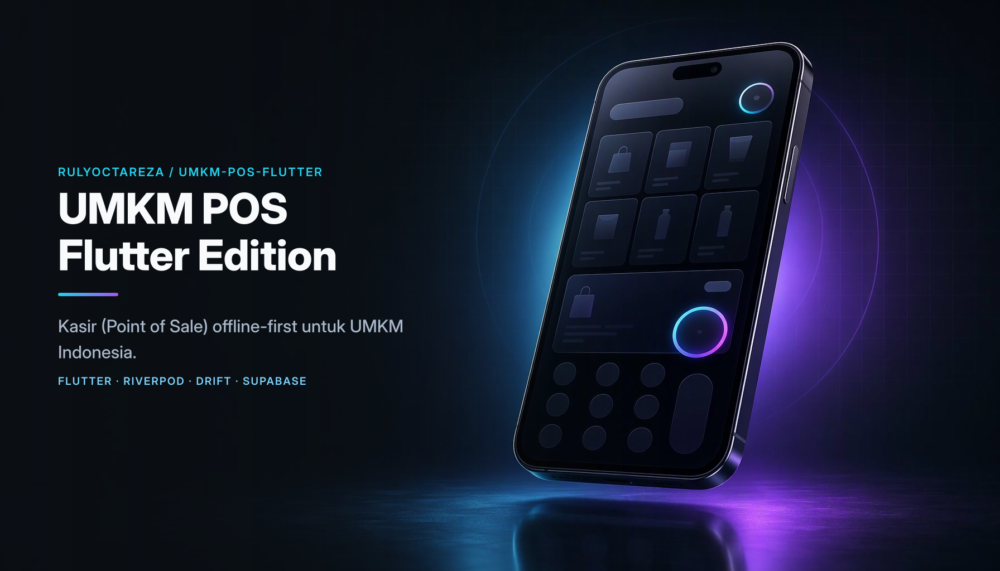
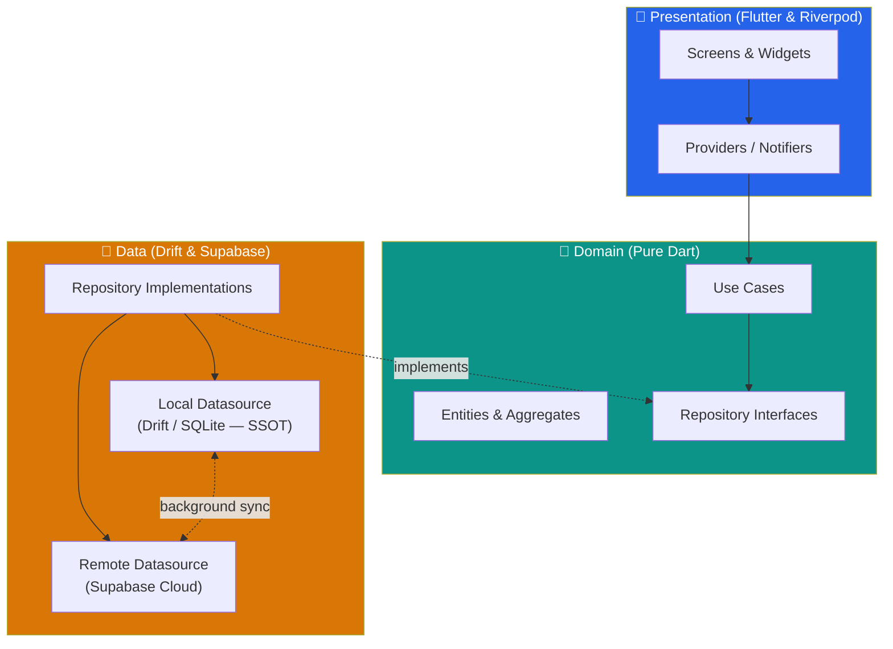
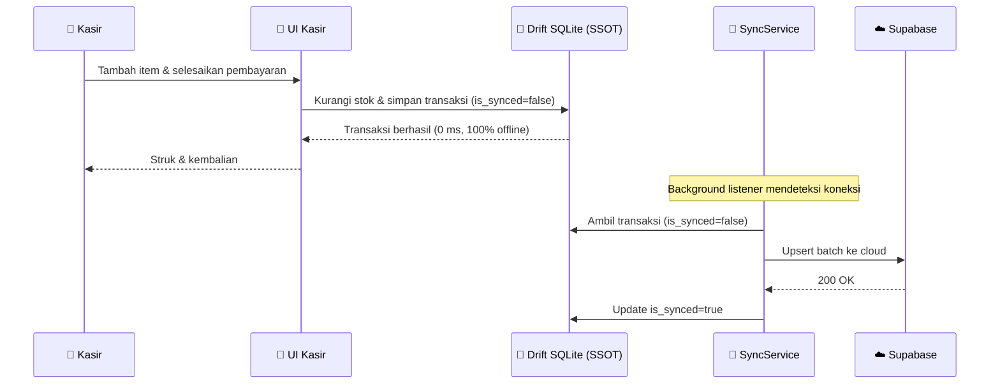

<p align="center">
  
</p>

<h1 align="center">UMKM POS — Flutter Edition</h1>

<p align="center">
  <b>Kasir (Point of Sale) offline-first untuk UMKM Indonesia.</b><br>
  Flutter · Clean Architecture · Riverpod · Drift (SQLite) · Supabase sync
</p>

<p align="center">
  <a href="https://flutter.dev"></a>
  <a href="https://dart.dev"></a>
  <a href="https://riverpod.dev"></a>
  <a href="https://drift.simonbinder.eu"></a>
  <a href="https://supabase.com"></a>
  
</p>

---

## ✨ Preview

<p align="center">
  
</p>

> **Catatan:** gambar di atas adalah *ilustrasi konsep* (bukan screenshot asli). Tangkapan layar
> aplikasi akan ditambahkan setelah build release pertama.

Satu codebase, responsif penuh untuk **ponsel dan tablet** (portrait & landscape) — tanpa
hardcoded breakpoint:

| Perangkat | Navigasi | Halaman Kasir |
|---|---|---|
| 📱 Smartphone (compact) | Bottom `NavigationBar` | Grid produk full-width + Floating Bar Keranjang & Modal Bottom Sheet |
| 💻 Tablet / Desktop (expanded) | Left `NavigationRail` | Grid produk (kiri) + Panel Keranjang permanen (side-by-side) |

---

## 📖 Tentang

Aplikasi kasir untuk warung dan toko kecil yang **tetap jalan tanpa internet**. Semua transaksi,
mutasi stok, dan kalkulasi kembalian disimpan langsung di SQLite lokal (single source of truth),
lalu disinkronkan dua arah ke Supabase saat perangkat kembali online.

---

## 🌟 Fitur Utama

| Fitur | Deskripsi |
|---|---|
| ⚡ **Kasir Cepat & Ergonomis** | Katalog grid responsif, tap untuk tambah pesanan, tombol minus ekstra besar (40×40 dp) di pojok kartu untuk kurangi/hapus item. |
| 📴 **100% Offline-First** | Transaksi, mutasi stok atomik, dan kembalian tersimpan di Drift/SQLite tanpa bergantung koneksi. |
| 🔄 **Background Sync** | Sinkronisasi otomatis ke Supabase saat perangkat kembali online. |
| 📋 **Katalog Fleksibel** | Default List View informatif dengan switcher Grid View, plus status stok tipis & habis. |
| 💳 **Multi Metode Bayar** | Tunai dengan numpad kembalian instan, QRIS statis/dinamis, dan transfer bank. |
| 🧾 **Struk Digital & PDF** | Bagikan struk via WhatsApp/teks, cetak bukti pembayaran PDF. |
| 📊 **Dashboard & Laporan** | Omzet hari ini, grafik transaksi bulanan, AOV, dan produk terlaris. |
| ⚡ **Demo Data Seeder** | Satu tap muat data demo UMKM (coffee shop & bakery) lengkap dengan foto produk. |
| 🌓 **Adaptive Theme** | Light/Dark mode dengan palet kontras tinggi yang nyaman untuk kasir. |

---

## 🏗️ Arsitektur

Clean Architecture dengan pendekatan **feature-first**:



### Alur Data Offline-First



---

## 🛠️ Tech Stack

| Area | Pilihan |
|---|---|
| Framework | Flutter (Dart 3) |
| State management | Riverpod + code generation |
| Database lokal | Drift (SQLite FFI) dengan reactive streams |
| Cloud sync | Supabase Flutter |
| Routing | GoRouter |
| Pendukung | `intl` (Rupiah `id_ID`), `cached_network_image`, `pdf` & `printing`, Phosphor Icons, Google Fonts (Outfit & Inter) |

---

## 🚀 Menjalankan

Prasyarat: Flutter ≥ 3.22, Dart ≥ 3.4.

```bash
git clone https://github.com/RulyOctareza/UMKM-Pos-Flutter.git
cd UMKM-Pos-Flutter

flutter pub get

# hanya jika skema Drift/Riverpod berubah
dart run build_runner build --delete-conflicting-outputs

flutter run
```

---

## 🧪 Testing

```bash
flutter analyze
flutter test --coverage
```

```text
00:07 +28: All tests passed! (28/28 — 100%)
```

---

## 📂 Struktur Proyek

```text
lib/
├── app/                  # Inisialisasi, router, tema & design tokens
│   ├── router.dart
│   └── theme/
├── core/                 # Shared widgets, utils, database & services
│   ├── database/         # Tabel Drift, in-memory DB, data seeder
│   ├── errors/           # Failure & Result pattern
│   ├── services/         # Receipt & PDF generation
│   ├── sync/             # Supabase offline sync engine
│   ├── utils/            # Currency & date formatters
│   └── widgets/          # ProductCard, Numpad, AppButtons, Badges
└── features/             # Feature-first architecture
    ├── auth/             # Onboarding & setup profil toko
    ├── cart/             # State keranjang
    ├── dashboard/        # Laporan penjualan & produk terlaris
    ├── products/         # CRUD produk, kategori, stok
    ├── settings/         # Pengaturan toko, tema, demo seeder
    └── transactions/     # Kasir, pembayaran, riwayat, detail
```

---

## 📄 Lisensi

MIT © Fatchurizkia Ruly Octareza

<p align="center">Dibuat dengan ❤️ untuk kemajuan UMKM Indonesia 🇮🇩</p>
